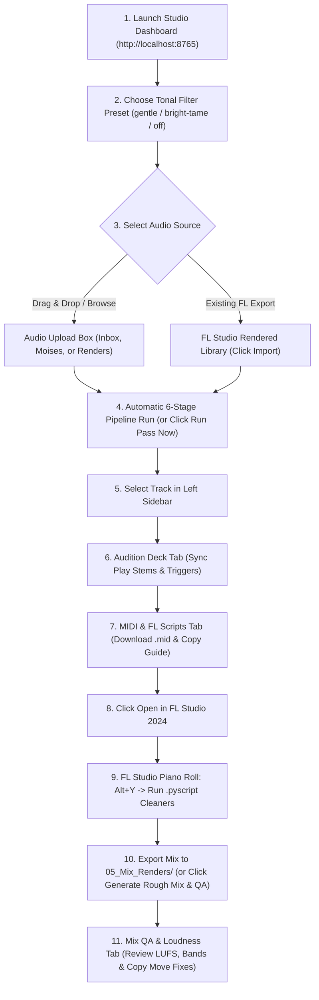
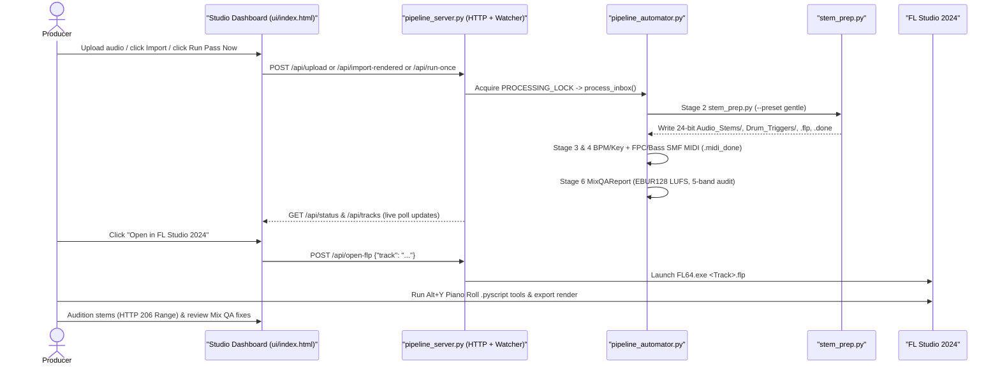

# Suno Music Pipeline Studio Dashboard & Automation Suite

Unified Dark-DAW Studio Web UI, multi-threaded HTTP automation server, and 6-stage DSP/MIDI/Mix-QA engine for turning Suno audio exports and separated stems into editable **FL Studio 2024** multitrack sessions.

---

## Overview

`studio-dashboard/` provides a self-contained, zero-framework web dashboard (`http://127.0.0.1:8765`) paired with a background automation engine (`pipeline_automator.py`), a Humanized Mix renderer (`humanized_mix.py`) and an HTTP control plane (`pipeline_server.py`).

### Production tab

1. For a full Suno mix, use the inbox and local Demucs. For a [Moises export](https://help.moises.ai/hc/en-us/articles/10554030191004-How-do-I-export-my-song-with-the-changes-made), choose **Separated Tracks**, unzip the files, select **Moises separated tracks** in the dashboard, enter the destination song name and select all its stems together.
2. Select the song and open **Production → Load waveforms**. Play, seek, solo, mute and adjust levels across the prepared stems. The browser remembers audition settings for each track. Use **Humanized Mix** to change the rendered audio.
3. In **Scaler 3 harmony**, download an instrument stem for Detect Audio or bass MIDI for Detect MIDI. Use the estimated key and tempo as starting points. Audition the harmony and drag the chosen progression from Scaler 3 into your DAW. See the [Scaler 3 user guide](https://downloads.scalermusic.com/Scaler-3_User_Guide.pdf).
4. To use [ML Studio](https://github.com/Dorfhaus/ML-Studio/tree/michael-lane), set `ML_STUDIO_EXE` to the absolute path of the installed executable and restart the server. On macOS use the executable inside the app bundle. The dashboard also checks for `mlstudio` and `lemonstudio` on PATH. **Open a working copy** launches a new sibling copy of the provisioned FL project each time. Import prepared stems and MIDI as needed, and save your arrangement in the DAW. Its AI panel supplies the [MCP configuration and permission controls](https://github.com/Dorfhaus/ML-Studio/blob/michael-lane/crates/os-app/src/ai_control.rs).
5. Generate a mix or import your DAW bounce into **05_Mix_Renders**. Choose that WAV in **Waveform video**, select landscape or vertical, and download the full-length H.264/AAC MP4. FFmpeg needs the showwaves filter and libx264 encoder. Keep the dashboard open during export.

### 6-Stage Automation Engine

| Stage | Pipeline Folder | Responsibility |
| :--- | :--- | :--- |
| **Stage 1** | `01_Suno_Inbox/` | Monitors incoming raw audio (`.wav`, `.mp3`, `.flac`, `.m4a`, `.ogg`), transcodes non-WAV uploads via FFmpeg to 24-bit PCM, routes grouped stems (`*_vocals`, `*_drums`, `*_bass`, `*_instruments`) directly to Stage 2, or triggers **Demucs** 4-stem separation on full mixes. |
| **Stage 2** | `02_Moises_Stems/<Track>/` &rarr; `03_Prepped_Stems/<Track>/` | Runs `pipeline/scripts/stem_prep/stem_prep.py` to apply tonal cleanup (`gentle`, `bright-tame`, or `off`), generate isolated `Kick` / `Snare` / `Hat` drum trigger WAVs, and provision `04_FL_Project/<Track>/<Track>.flp` non-destructively from `Templates/Project_Template.flp`. |
| **Stage 3** | `03_Prepped_Stems/<Track>/MIDI/` | Estimates **BPM** (then fits it to the actual kick/snare hits, so the grid doesn't drift over the song), the **downbeat** (handles pickups / silent intros) and **musical key + scale notes** (Krumhansl-Schmuckler). Transcribes `Drum_Triggers/` into clean, repeatable FPC-mapped MIDI (`*_FPC_Drums.mid`). |
| **Stage 4** | `03_Prepped_Stems/<Track>/MIDI/` | Transcribes the bass stem into clean MIDI (`*_Bass.mid`) with YIN pitch tracking (no octave errors) and a level gate relative to the stem. |
| **Humanized Mix** | `05_Mix_Renders/<Track>_Humanized.wav` | Re-performs drums and bass from the MIDI with a human timing/velocity model, re-plays them with drum hits sampled from the song's own stem and a bass synth, and mixes them with the vocal/instrument stems. See [Humanized Mix](#humanized-mix). |
| **Stage 5** | `04_FL_Project/<Track>/<Track>.flp` | Launches **FL Studio 2024** (`FL64.exe`) directly on the provisioned `.flp` session and pairs with the installed Piano Roll `.pyscript` tools (`FPC_Drum_Mapper_Humanizer.pyscript`, `Groove_Humanize.pyscript`, `Stem_MIDI_Cleaner.pyscript`). |
| **Stage 6** | `05_Mix_Renders/` | Renders a reference rough mix (original stems) and audits every render: **integrated LUFS**, **True Peak (dBTP)**, **Crest Factor**, **LRA**, spectral balance, stereo/mono compatibility, and timestamped FL Studio fixes (`*_Mix_QA_Report.md`). Every value is measured (ffmpeg `ebur128`, or the built-in ITU-R BS.1770 meter when ffmpeg is missing). Fixes are only listed for issues that were actually detected. |

**Failures don't loop.** If a step fails (Demucs missing, `stem_prep.py` crashes, a corrupt WAV), it is recorded in `Automation/failures.json`, shown on the track in the dashboard with the error, and **not retried until its input files change** or you click **Retry now** / **Re-Process Track**.

---

## Humanized Mix

The goal: turn the AI-separated stems into a mix where the rhythm section sounds *played*, not generated.

1. **Clean transcription.** Stages 3/4 write deterministic, un-humanized MIDI. Edit it in FL Studio and save it back to `MIDI/`, and the next render follows your edit.
2. **Human performance model** (`humanize_notes`), seeded so every render is repeatable:
   - a slow, shared *band drift*: the whole band breathes together,
   - smaller per-player drift (correlated, like a real player, not random noise per hit),
   - per-hit micro-jitter, snare and bass laid back on beats 2 and 4, hats pushed slightly ahead,
   - optional 16th-note swing,
   - beat-position velocity accents, and no two identical "machine-gun" hits in a row.

   The performance is saved as `*_FPC_Drums_Humanized.mid` and `*_Bass_Humanized.mid` for FL Studio.
3. **Re-play it.** Drums are re-triggered from one-shots cut out of **this song's own drum stem**. Only cleanly isolated hits are used, found via the trigger WAVs, with up to 4 round-robin variations per drum. Synthesized hits are a fallback only. Bass is played by a small additive synth. Each part is level-matched to the original stem and also written to `03_Prepped_Stems/<Track>/Humanized_Stems/` so you can drag it into FL Studio.
4. **Mix & master.** Drums can *replace* the original (keeping the original's cymbals and air above 7 kHz), *layer* with it, or stay *original*. Bass works the same way. The result is normalised to a loudness target (default -14 LUFS) through a true-peak-aware limiter (ceiling -1 dBTP). The rough mix uses the same mastering, so the dashboard's **A/B Listen** compares them at equal loudness.

In the dashboard, the **Humanized Mix** tab has sliders for humanize amount, swing, drum/bass mode and blend, per-bus levels and target loudness:
- **Render** reuses the current take.
- **New Take** rolls a new seed, giving a different performance of the same part.

With **Auto Humanize** on (the default; `--no-auto-humanize` turns it off), every new track gets a humanized mix automatically after its MIDI is ready.

The model is statistical (no ML model or network calls). It runs locally in a few seconds per song.

---

## Folder Structure (`studio-dashboard/`)

```text
studio-dashboard/
├── .gitignore
├── README.md
├── requirements.txt
├── pipeline_automator.py          # Core 6-stage DSP, Demucs, MIDI, loudness meter and Mix QA engine
├── humanized_mix.py               # Humanize model, drum resampler, bass synth, mix & master
├── pipeline_server.py             # Multi-threaded HTTP server, watcher daemon, and REST API
├── ui/
│   └── index.html                 # Single-page Dark-DAW Studio Dashboard
├── launchers/
│   ├── Launch_Suno_Pipeline_Dashboard.bat
│   ├── Start_Suno_Music_Pipeline_Watch.bat
│   ├── Stop_Suno_Music_Pipeline_Watch.bat
│   └── Run_Suno_Pipeline_Once.bat
└── tests/
    ├── __init__.py
    ├── fixtures.py                # Synthetic tracks so tests run on any machine
    ├── test_pipeline_automator.py
    └── test_pipeline_server.py
```

---

## Prerequisites & Quick Start

### Prerequisites

- **Python 3.10+** (tested on Python 3.13)
- **FFmpeg** available on `PATH` (or passed via `--ffmpeg`) for `stem_prep.py` and for transcoding non-WAV uploads. Loudness analysis falls back to the built-in BS.1770 meter without it.
- **Optional:** Demucs for automatic 4-stem separation of full mixes dropped into `01_Suno_Inbox/`. By default it runs with `py -3.10` on Windows (when the `py` launcher exists) or the current Python elsewhere; override with `DEMUCS_PYTHON`.
- **Optional (Windows Production):** **FL Studio 2024** (`C:\Program Files (x86)\Image-Line\FL Studio 2024\FL64.exe`)

### Installation & Launch

```bash
pip install -r studio-dashboard/requirements.txt
python studio-dashboard/pipeline_server.py --base-dir C:/Music_Pipeline
```

Then open **`http://localhost:8765`** in your browser (or double-click `studio-dashboard/launchers/Launch_Suno_Pipeline_Dashboard.bat` on Windows).

### Environment Variables (Portable Overrides)

| Variable | Default Resolution | Purpose |
| :--- | :--- | :--- |
| `MUSIC_PIPELINE_DIR` | `C:/Music_Pipeline` | Overrides `--base-dir` root working directory. |
| `STEM_PREP_SCRIPT` | `../pipeline/scripts/stem_prep/stem_prep.py` (or `~/Code/Suno-Music-Creator/...`) | Overrides path to `stem_prep.py`. |
| `FL_RENDERED_DIR` | `~/OneDrive/Documents/Image-Line/FL Studio/Audio/Rendered` (fallback `~/Documents/...`) | Overrides the FL Studio Rendered Library folder scanned for 1-click stem imports. |
| `FL_STUDIO_EXE` | `C:\Program Files (x86)\Image-Line\FL Studio 2024\FL64.exe` | Path to FL Studio for **Open in FL Studio**. |
| `DEMUCS_PYTHON` | `py -3.10` on Windows, else the current Python | Python command used to run `-m demucs` (e.g. a venv's `python.exe`). |

---

## Workflow Architecture Diagrams

### Master Click-Sequence Workflow



### Behind-the-Scenes Sequence Diagram



---

## Complete Click-by-Click Walkthrough

### Phase A: Studio Dashboard (`http://localhost:8765`)

1. **Start the Server & Open UI**
   - Run `python studio-dashboard/pipeline_server.py --base-dir C:/Music_Pipeline` (or run `launchers/Launch_Suno_Pipeline_Dashboard.bat`).
   - Verify the top status pill transitions from `INITIALIZING...` to live **WATCHER ACTIVE** status.
2. **Configure Global Controls (Header Bar)**
   - **Tonal Filter**: Select `gentle (Default)`, `bright-tame (Harsh Top-End Tamer)`, or `off (Bypass EQ)`.
   - **Pause Watcher / Resume Watcher**: Toggle background folder watching on or off.
   - **Run Pass Now**: Force an immediate single-pass scan across Stages 1–6.
   - **Open Pipeline Folder**: Open `C:\Music_Pipeline` (or click any Stage KPI card to jump straight to `01_Suno_Inbox` through `05_Mix_Renders`).
3. **Ingest Audio (Left Sidebar)**
   - **Audio Upload Box**: Choose target (`01_Suno_Inbox`, `02_Moises_Stems (Current Track)`, or `05_Mix_Renders`) and drag-and-drop `.wav`, `.mp3`, `.flac`, `.m4a`, or `.ogg` files (non-WAV formats are automatically transcoded to 24-bit PCM WAV).
   - **FL Studio Rendered Library**: Click **Import** next to any detected 4-stem set from FL Studio's `Rendered` directory to route stems and trigger processing automatically.
4. **Inspect & Audition a Track (Right Workspace)**
   - Select any track in **Track Pipeline** to view detected **BPM**, **Key**, **Scale Pills**, active preset, and stage badge.
   - **Audition Deck (Stems & Triggers)**: Play individual 24-bit stems or drum triggers with instant byte-range seeking, or toggle **Sync Play All Stems** for synchronized multitrack auditioning.
   - **MIDI & FL Scripts**: Download generated `*_FPC_Drums.mid` and `*_Bass.mid` files, or click to open the track's `MIDI/` folder.
   - **Mix QA & Loudness Analyzer**: Click **Generate Rough Mix & QA** (or inspect an imported render) to review **Integrated Loudness (LUFS)**, **True Peak (dBTP)**, **Crest Factor**, **LRA**, 5-band diagnostics, and click **Copy Move** on any timestamped FL Studio fix suggestion.
5. **Re-Process or Launch DAW**
   - Use **Re-Process Track** to invalidate `.done` / `.midi_done` markers and re-run with a new tonal filter preset.
   - Click **Open in FL Studio 2024** to launch the provisioned `.flp` session.

### Phase B: FL Studio 2024 Integration & Piano Roll Scripts

Ensure the `.pyscript` files from `pipeline/scripts/fl_studio/` are copied to FL Studio's `Settings\Piano roll scripts` folder. Inside FL Studio 2024:

1. Drag the generated `*_FPC_Drums.mid` into your **FPC** channel and `*_Bass.mid` into your bass synth/sampler channel.
2. Open the Piano Roll (`F7`), then go to **`Tools > Scripting`** (or press **`Alt+Y`**):
   - **`FPC_Drum_Mapper_Humanizer.pyscript`**: Maps separated kick (`C3`), snare (`E3`), and closed hi-hat (`F#3`) triggers onto standard FPC pads with dynamic velocity scaling and `+4` tick backbeat lay-back.
   - **`Groove_Humanize.pyscript`**: Adds natural micro-timing shifts, swing push/pull, and velocity humanization to bass or melodic MIDI.
   - **`Stem_MIDI_Cleaner.pyscript`**: Removes ghost triggers, de-overlaps simultaneous note collisions, and tightens transcription artifacts to grid anchors.
3. Export your mix WAV to `05_Mix_Renders/` (or upload it in the Dashboard) for automated Stage 6 Mix QA auditing.

---

## REST API Reference

All file paths passed to query/body parameters are strictly sandboxed within `--base-dir` via `is_safe_path()`.

**Security.** The server binds to `127.0.0.1` and has no login, so it protects itself from other websites open in your browser:
- Requests whose `Host` isn't `localhost`, `127.0.0.1` or `::1` are refused. This blocks DNS-rebinding attacks.
- Requests with a foreign `Origin` are refused.
- No CORS headers are sent.
- Every POST except `/api/upload` must be `Content-Type: application/json`.
- Uploads must be binary (`application/octet-stream` or `audio/*`) or JSON.

If you deliberately expose the dashboard on a LAN with `--host 0.0.0.0`, add `--allow-host <your-ip>`, and only do it on a network you trust.

| Method | Endpoint | Description | Request Parameters / Body |
| :--- | :--- | :--- | :--- |
| `GET` | `/` or `/index.html` | Serves the Dark-DAW Studio Web UI (`ui/index.html`). | — |
| `GET` | `/api/status` | Returns watcher state, PID, active preset, busy task status, folder counts, and recent log lines. | — |
| `GET` | `/api/tracks` | Discovers all pipeline tracks across Stages 1–6, metadata (BPM/Key/Scale), stems, MIDI, FLP state, Mix QA data, and FL Rendered sets. | — |
| `GET` | `/api/audio` | Streams audio with full **HTTP 206 Partial Content** (`Range: bytes=...`) support for scrubbing. | `?path=<rel_path>` |
| `GET` | `/api/download` | Downloads stems, MIDI files, Mix QA reports, or rough mixes as attachments. | `?path=<rel_path>` |
| `POST` | `/api/upload` | Uploads audio (raw binary stream or JSON `data_base64`), transcodes non-WAV to 24-bit PCM via FFmpeg, and invalidates stale markers. | Query `?target=inbox\|moises\|renders&filename=<name>&track=<track>` (or JSON body) |
| `POST` | `/api/watcher` | Updates watcher state, Auto Humanize, and the active tonal filter preset. | `{"running": true\|false, "auto_humanize": true\|false, "preset": "gentle"\|"bright-tame"\|"off"}` |
| `POST` | `/api/run-once` | Triggers an asynchronous single-pass pipeline run across Stages 1–6 (returns `409 Conflict` if busy). | Optional `{"preset": "gentle"\|"bright-tame"\|"off"}` |
| `POST` | `/api/import-rendered` | Imports a 4-stem set from FL Studio's `Rendered` directory into `02_Moises_Stems/<Track>/` and runs processing. | `{"base_name": "<StemSetBase>", "preset": "gentle"}` |
| `POST` | `/api/reprocess` | Queues a rebuild: once the processing lock is held, removes the track's `.done` / `.midi_done` markers, generated mixes and recorded failures, then re-runs stem prep, MIDI and mixes with the given preset. | `{"track": "<TrackName>", "preset": "gentle"}` |
| `POST` | `/api/generate-rough-mix` | Sums the original prepped stems into `05_Mix_Renders/<Track>_RoughMix.wav` (same mastering as the humanized mix) and writes its Mix QA report. | `{"track": "<TrackName>"}` |
| `POST` | `/api/humanize` | Renders `05_Mix_Renders/<Track>_Humanized.wav`, humanized MIDI and re-performed stems. `new_take: true` rolls a new seed. | `{"track": "...", "settings": {"humanize": 0.5, "swing": 0, "drums_mode": "replace", "bass_mode": "layer", "target_lufs": -14, ...}, "new_take": false}` |
| `POST` | `/api/clear-failure` | Clears recorded failures for a track so the watcher retries it. | `{"track": "<TrackName>"}` |
| `POST` | `/api/open-flp` | Launches `FL64.exe` with `04_FL_Project/<Track>/<Track>.flp`. | `{"track": "<TrackName>"}` |
| `POST` | `/api/open-folder` | Opens an existing sandboxed pipeline sub-folder (Explorer on Windows). | `{"rel_path": "03_Prepped_Stems"}` |

---

## Running Tests

From the repository root:

```bash
pip install -r studio-dashboard/requirements.txt
python -m unittest discover -s studio-dashboard/tests -t studio-dashboard -v
```

The tests build synthetic tracks in a temp folder (`tests/fixtures.py`), so they need no music library and run on Windows, macOS and Linux.
