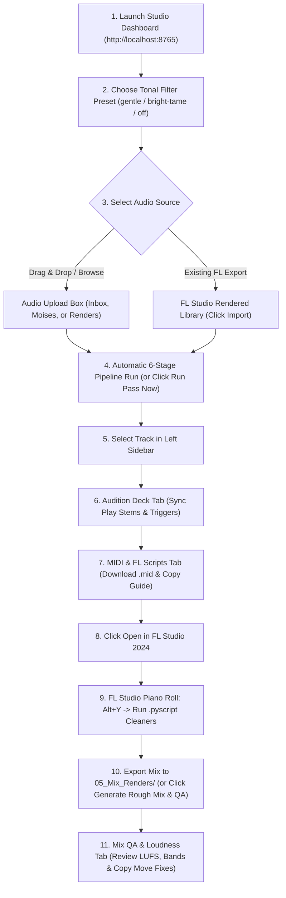
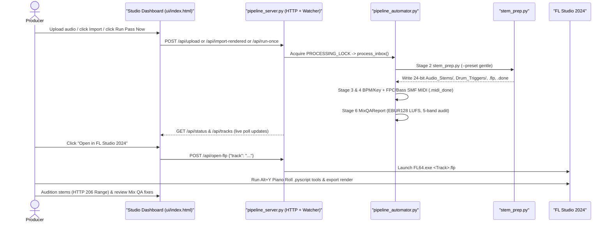

# Suno Music Pipeline Studio Dashboard & Automation Suite

Unified Dark-DAW Studio Web UI, multi-threaded HTTP automation server, and 6-stage DSP/MIDI/Mix-QA engine for turning Suno audio exports and separated stems into editable **FL Studio 2024** multitrack sessions.

---

## Overview

`studio-dashboard/` provides a self-contained, zero-framework web dashboard (`http://127.0.0.1:8765`) paired with a background automation engine (`pipeline_automator.py`) and HTTP control plane (`pipeline_server.py`).

### 6-Stage Automation Engine

| Stage | Pipeline Folder | Responsibility |
| :--- | :--- | :--- |
| **Stage 1** | `01_Suno_Inbox/` | Monitors incoming raw audio (`.wav`, `.mp3`, `.flac`, `.m4a`, `.ogg`), transcodes non-WAV uploads via FFmpeg to 24-bit PCM, routes grouped stems (`*_vocals`, `*_drums`, `*_bass`, `*_instruments`) directly to Stage 2, or triggers **Demucs** 4-stem separation on full mixes. |
| **Stage 2** | `02_Moises_Stems/<Track>/` &rarr; `03_Prepped_Stems/<Track>/` | Runs `pipeline/scripts/stem_prep/stem_prep.py` to apply tonal cleanup (`gentle`, `bright-tame`, or `off`), generate isolated `Kick` / `Snare` / `Hat` drum trigger WAVs, and provision `04_FL_Project/<Track>/<Track>.flp` non-destructively from `Templates/Project_Template.flp`. |
| **Stage 3** | `03_Prepped_Stems/<Track>/MIDI/` | Estimates **BPM** and **musical key + scale notes** (Krumhansl-Schmuckler profile matching) and transcribes `Drum_Triggers/` into GM/FPC-mapped Standard MIDI Files (`*_FPC_Drums.mid`). |
| **Stage 4** | `03_Prepped_Stems/<Track>/MIDI/` | Transcribes bass stems into clean pitch-quantized Standard MIDI Files (`*_Bass.mid`) with onset gating and zero-external-dependency SMF binary serialization. |
| **Stage 5** | `04_FL_Project/<Track>/<Track>.flp` | Launches **FL Studio 2024** (`FL64.exe`) directly on the provisioned `.flp` session and pairs with the installed Piano Roll `.pyscript` tools (`FPC_Drum_Mapper_Humanizer.pyscript`, `Groove_Humanize.pyscript`, `Stem_MIDI_Cleaner.pyscript`). |
| **Stage 6** | `05_Mix_Renders/` | Sums prepped stems into a rough mix or audits exported renders with **EBUR128 LUFS**, **True Peak (dBTP)**, **Crest Factor**, **LRA**, 5-band spectral balance, and timestamped FL Studio actionable fix lists (`*_Mix_QA_Report.md`). |

---

## Folder Structure (`studio-dashboard/`)

```text
studio-dashboard/
├── .gitignore
├── README.md
├── requirements.txt
├── pipeline_automator.py          # Core 6-stage DSP, Demucs, MIDI, and Mix QA engine
├── pipeline_server.py             # Multi-threaded HTTP server, watcher daemon, and REST API
├── ui/
│   └── index.html                 # Single-page Dark-DAW Studio Dashboard
├── launchers/
│   ├── Launch_Suno_Pipeline_Dashboard.bat
│   ├── Start_Suno_Music_Pipeline_Watch.bat
│   ├── Stop_Suno_Music_Pipeline_Watch.bat
│   └── Run_Suno_Pipeline_Once.bat
└── tests/
    ├── __init__.py
    ├── test_pipeline_automator.py
    └── test_pipeline_server.py
```

---

## Prerequisites & Quick Start

### Prerequisites

- **Python 3.10+** (tested on Python 3.13)
- **FFmpeg** available on `PATH` (or passed via `--ffmpeg`) for multi-format transcoding and rough mix / EBUR128 loudness analysis
- **Optional:** `demucs` on Python `PATH` for automatic 4-stem separation of solitary full mixes dropped into `01_Suno_Inbox/`
- **Optional (Windows Production):** **FL Studio 2024** (`C:\Program Files (x86)\Image-Line\FL Studio 2024\FL64.exe`)

### Installation & Launch

```bash
pip install -r studio-dashboard/requirements.txt
python studio-dashboard/pipeline_server.py --base-dir C:/Music_Pipeline
```

Then open **`http://localhost:8765`** in your browser (or double-click `studio-dashboard/launchers/Launch_Suno_Pipeline_Dashboard.bat` on Windows).

### Environment Variables (Portable Overrides)

| Variable | Default Resolution | Purpose |
| :--- | :--- | :--- |
| `MUSIC_PIPELINE_DIR` | `C:/Music_Pipeline` | Overrides `--base-dir` root working directory. |
| `STEM_PREP_SCRIPT` | `../pipeline/scripts/stem_prep/stem_prep.py` (or `~/Code/Suno-Music-Creator/...`) | Overrides path to `stem_prep.py`. |
| `FL_RENDERED_DIR` | `~/OneDrive/Documents/Image-Line/FL Studio/Audio/Rendered` (fallback `~/Documents/...`) | Overrides the FL Studio Rendered Library folder scanned for 1-click stem imports. |

---

## Workflow Architecture Diagrams

### Master Click-Sequence Workflow



### Behind-the-Scenes Sequence Diagram



---

## Complete Click-by-Click Walkthrough

### Phase A: Studio Dashboard (`http://localhost:8765`)

1. **Start the Server & Open UI**
   - Run `python studio-dashboard/pipeline_server.py --base-dir C:/Music_Pipeline` (or run `launchers/Launch_Suno_Pipeline_Dashboard.bat`).
   - Verify the top status pill transitions from `INITIALIZING...` to live **WATCHER ACTIVE** status.
2. **Configure Global Controls (Header Bar)**
   - **Tonal Filter**: Select `gentle (Default)`, `bright-tame (Harsh Top-End Tamer)`, or `off (Bypass EQ)`.
   - **Pause Watcher / Resume Watcher**: Toggle background folder watching on or off.
   - **Run Pass Now**: Force an immediate single-pass scan across Stages 1–6.
   - **Open Pipeline Folder**: Open `C:\Music_Pipeline` (or click any Stage KPI card to jump straight to `01_Suno_Inbox` through `05_Mix_Renders`).
3. **Ingest Audio (Left Sidebar)**
   - **Audio Upload Box**: Choose target (`01_Suno_Inbox`, `02_Moises_Stems (Current Track)`, or `05_Mix_Renders`) and drag-and-drop `.wav`, `.mp3`, `.flac`, `.m4a`, or `.ogg` files (non-WAV formats are automatically transcoded to 24-bit PCM WAV).
   - **FL Studio Rendered Library**: Click **Import** next to any detected 4-stem set from FL Studio's `Rendered` directory to route stems and trigger processing automatically.
4. **Inspect & Audition a Track (Right Workspace)**
   - Select any track in **Track Pipeline** to view detected **BPM**, **Key**, **Scale Pills**, active preset, and stage badge.
   - **Audition Deck (Stems & Triggers)**: Play individual 24-bit stems or drum triggers with instant byte-range seeking, or toggle **Sync Play All Stems** for synchronized multitrack auditioning.
   - **MIDI & FL Scripts**: Download generated `*_FPC_Drums.mid` and `*_Bass.mid` files, or click to open the track's `MIDI/` folder.
   - **Mix QA & Loudness Analyzer**: Click **Generate Rough Mix & QA** (or inspect an imported render) to review **Integrated Loudness (LUFS)**, **True Peak (dBTP)**, **Crest Factor**, **LRA**, 5-band diagnostics, and click **Copy Move** on any timestamped FL Studio fix suggestion.
5. **Re-Process or Launch DAW**
   - Use **Re-Process Track** to invalidate `.done` / `.midi_done` markers and re-run with a new tonal filter preset.
   - Click **Open in FL Studio 2024** to launch the provisioned `.flp` session.

### Phase B: FL Studio 2024 Integration & Piano Roll Scripts

Ensure the `.pyscript` files from `pipeline/scripts/fl_studio/` are copied to FL Studio's `Settings\Piano roll scripts` folder. Inside FL Studio 2024:

1. Drag the generated `*_FPC_Drums.mid` into your **FPC** channel and `*_Bass.mid` into your bass synth/sampler channel.
2. Open the Piano Roll (`F7`), then go to **`Tools > Scripting`** (or press **`Alt+Y`**):
   - **`FPC_Drum_Mapper_Humanizer.pyscript`**: Maps separated kick (`C3`), snare (`E3`), and closed hi-hat (`F#3`) triggers onto standard FPC pads with dynamic velocity scaling and `+4` tick backbeat lay-back.
   - **`Groove_Humanize.pyscript`**: Adds natural micro-timing shifts, swing push/pull, and velocity humanization to bass or melodic MIDI.
   - **`Stem_MIDI_Cleaner.pyscript`**: Removes ghost triggers, de-overlaps simultaneous note collisions, and tightens transcription artifacts to grid anchors.
3. Export your mix WAV to `05_Mix_Renders/` (or upload it in the Dashboard) for automated Stage 6 Mix QA auditing.

---

## REST API Reference

All file paths passed to query/body parameters are strictly sandboxed within `--base-dir` via `is_safe_path()`.

| Method | Endpoint | Description | Request Parameters / Body |
| :--- | :--- | :--- | :--- |
| `GET` | `/` or `/index.html` | Serves the Dark-DAW Studio Web UI (`ui/index.html`). | — |
| `GET` | `/api/status` | Returns watcher state, PID, active preset, busy task status, folder counts, and recent log lines. | — |
| `GET` | `/api/tracks` | Discovers all pipeline tracks across Stages 1–6, metadata (BPM/Key/Scale), stems, MIDI, FLP state, Mix QA data, and FL Rendered sets. | — |
| `GET` | `/api/audio` | Streams audio with full **HTTP 206 Partial Content** (`Range: bytes=...`) support for scrubbing. | `?path=<rel_path>` |
| `GET` | `/api/download` | Downloads stems, MIDI files, Mix QA reports, or rough mixes as attachments. | `?path=<rel_path>` |
| `POST` | `/api/upload` | Uploads audio (raw binary stream or JSON `data_base64`), transcodes non-WAV to 24-bit PCM via FFmpeg, and invalidates stale markers. | Query `?target=inbox\|moises\|renders&filename=<name>&track=<track>` (or JSON body) |
| `POST` | `/api/watcher` | Updates background watcher enabled state and active tonal filter preset. | `{"running": true\|false, "preset": "gentle"\|"bright-tame"\|"off"}` |
| `POST` | `/api/run-once` | Triggers an asynchronous single-pass pipeline run across Stages 1–6 (returns `409 Conflict` if busy). | Optional `{"preset": "gentle"\|"bright-tame"\|"off"}` |
| `POST` | `/api/import-rendered` | Imports a 4-stem set from FL Studio's `Rendered` directory into `02_Moises_Stems/<Track>/` and runs processing. | `{"base_name": "<StemSetBase>", "preset": "gentle"}` |
| `POST` | `/api/reprocess` | Invalidates `.done` and `.midi_done` markers for a track and re-runs stem prep & MIDI generation. | `{"track": "<TrackName>", "preset": "gentle"}` |
| `POST` | `/api/generate-rough-mix` | Sums prepped stems into `05_Mix_Renders/<Track>_RoughMix.wav` via FFmpeg and generates its Mix QA report. | `{"track": "<TrackName>"}` |
| `POST` | `/api/open-flp` | Launches `FL64.exe` with `04_FL_Project/<Track>/<Track>.flp`. | `{"track": "<TrackName>"}` |
| `POST` | `/api/open-folder` | Opens Windows Explorer at a sandboxed pipeline sub-folder. | `{"rel_path": "03_Prepped_Stems"}` |

---

## Running Tests

From the repository root:

```bash
python -m unittest discover -s studio-dashboard/tests -t studio-dashboard -v
```
